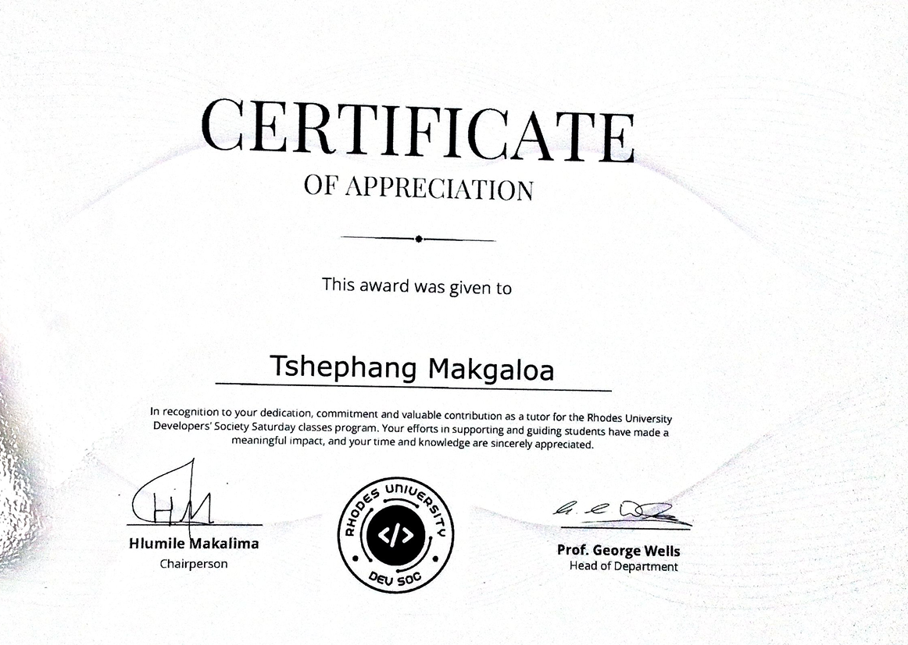

## 👤 Who I Am

I'm **Tshephang Makgaloa**, a Computer Science student based in South Africa with a passion for software development, particularly in Java and game development.

## 🎓 Education
- **Computer Science Student** - [Your University]

## 💼 Experience
- **Team Apollo** - Flappy Bird 2.0 Project
  - Collaborated with 3 other developers
  - Built a complete game using Java Swing
  - Implemented game mechanics, graphics, and event handling

## 💻 Technical Skills
- **Languages:** Java, JavaScript, HTML5, CSS3, Elm
- **Frameworks:** Java Swing, AWT
- **Concepts:** OOP, Data Structures, Event-Driven Programming, GUI Development
- **Tools:** Git, GitHub, JUnit

## 🌱 What I'm Learning
- Advanced Java concepts
- Web development
- Game development techniques

## 🎯 Goals
- Build more complex applications
- Contribute to open source
- Gain experience in software development

## 🏆 Achievements & Recognition

### Rhodes University Tutor Certificate of Appreciation

I was awarded a Certificate of Appreciation in recognition of my dedication, commitment, and valuable contribution as a tutor for Rhodes University.

## 📫 Let's Connect
I'm always open to collaboration and interesting conversations!

[GitHub](https://github.com/mastersflash19) | [LinkedIn](https://linkedin.com/in/yourprofile) | [Email](mailto:your.email@example.com)
